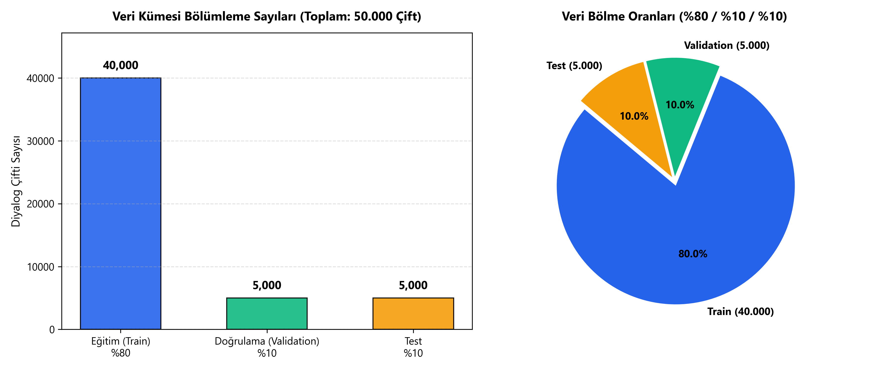
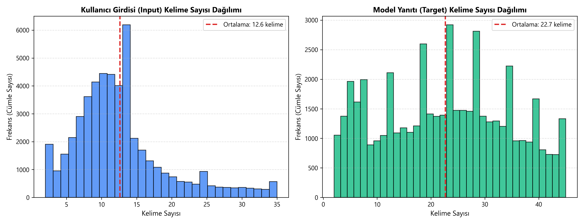
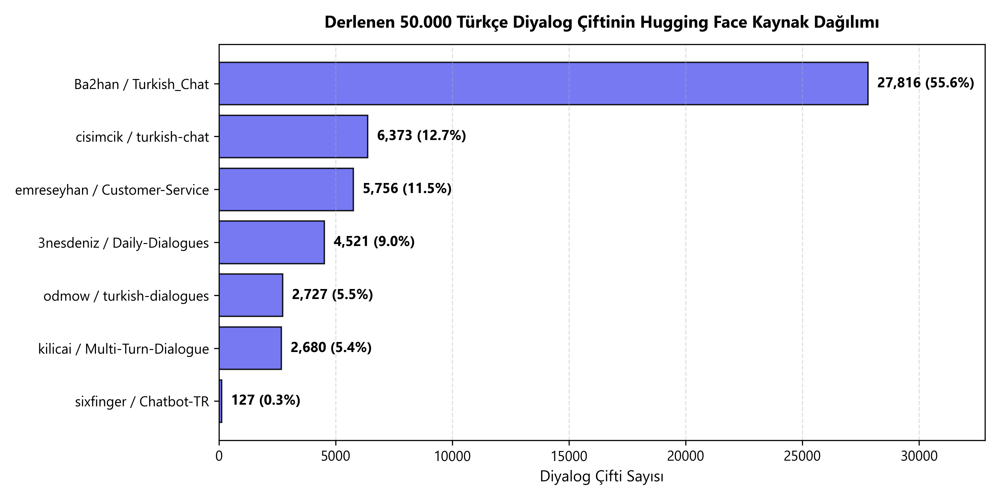
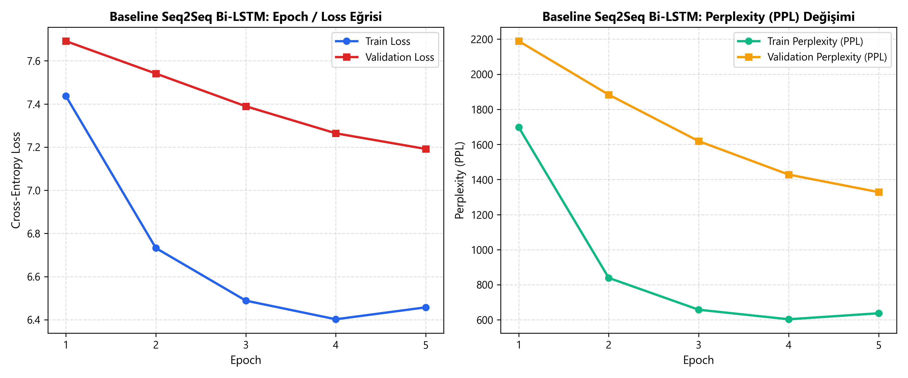
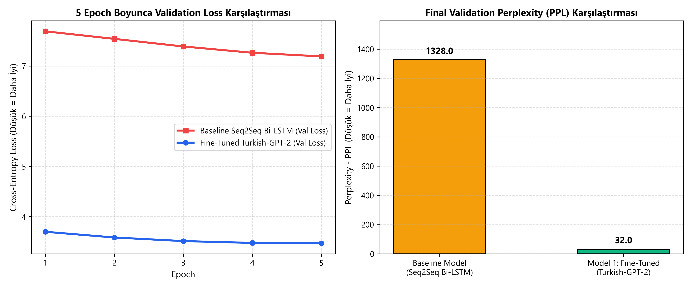
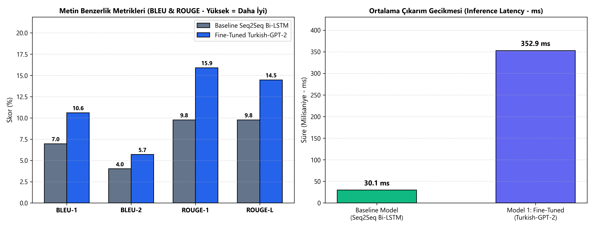

# Önceden Eğitilmiş Türkçe Modellerle İnce Ayar (Fine-Tuning) Tabanlı Chatbot Geliştirme ve Seq2Seq Karşılaştırmalı Başarım Analizi

**Öğrenci:** Seyit Ali Arslan (`240711024`)  
**Bölüm:** Yapay Zeka ve Veri Mühendisliği, Atatürk Üniversitesi  
**Ders:** Deep Learning (`2026–2027`)  

---

## 📄 IEEE Resmi Ara Sunum Belgeleri (LaTeX & PDF)

- **IEEE Konferans Formatlı Ara Rapor (PDF):** [`ara_rapor_ieee.pdf`](./ara_rapor_ieee.pdf) | Kaynak Kod: [`ara_rapor_ieee.tex`](./ara_rapor_ieee.tex)
- **IEEE Akademik Sunum Slaytları - Beamer 16:9 (PDF):** [`ara_sunum_ieee_beamer.pdf`](./ara_sunum_ieee_beamer.pdf) | Kaynak Kod: [`ara_sunum_ieee_beamer.tex`](./ara_sunum_ieee_beamer.tex)
- **Slayt-Slayt Konuşmacı Notları ve Rehber:** [`ARA_SUNUM_RAPORU.md`](./ARA_SUNUM_RAPORU.md)

---

## 📊 Ara Sunum (Midterm) Deneysel Karşılaştırma Özeti

Yerel **NVIDIA GeForce RTX 4060 Laptop GPU (8 GB VRAM, CUDA 12.4)** üzerinde **50.000 Türkçe diyalog çifti** (`40.000` Train / `5.000` Validation / `5.000` Test) kullanılarak sıfırdan eğitilen **2 Katmanlı Seq2Seq Bi-LSTM + Bahdanau Attention (Baseline)** modeli ile ince ayar yapılan **Fine-Tuned Turkish-GPT-2 (Model 1)** modelinin karşılaştırmalı sonuçları:

| Değerlendirme Metriği | Baseline Model (Seq2Seq Bi-LSTM + Bahdanau Attention) | Model 1: Fine-Tuned Transformer (`Turkish-GPT-2`) | Başarım Değişimi / Yorum |
| :--- | :---: | :---: | :--- |
| **Parametre Sayısı** | `23,110,112` (~23.1M) | `124,440,576` (~124.4M) | Önceden eğitilmiş zengin Türkçe temsil |
| **Validation Loss ($\downarrow$)** | `7.1915` | **`3.4666`** | **%51.8 daha düşük hata** |
| **Validation Perplexity - PPL ($\downarrow$)** | `1328.04` | **`32.03`** | **41.5 kat iyileşme** |
| **BLEU-1 (%) ($\uparrow$)** | `6.96` | **`10.60`** | **+%52.3 artış** |
| **BLEU-2 (%) ($\uparrow$)** | `4.02` | **`5.70`** | **+%41.8 artış** |
| **ROUGE-1 (%) ($\uparrow$)** | `9.76` | **`15.89`** | **+%62.8 artış** |
| **ROUGE-L (%) ($\uparrow$)** | `9.76` | **`14.47`** | **+%48.3 artış** |
| **Ortalama Yanıt Süresi - Latency ($\downarrow$)** | **`30.07 ms`** | `352.90 ms` | Her iki model de gerçek zamanlı (`< 0.4 sn`) |

---

## 📈 Üretilen Görselleştirmeler ve Grafikler (`figures/`)

### 1. Veri Bölümleme ve Keşifsel Veri Analizi (EDA)
| Veri Bölümleme (%80 / %10 / %10) | Kelime Uzunluğu Dağılımı | Veri Kaynakları Dağılımı |
| :---: | :---: | :---: |
|  |  |  |

### 2. Model Eğitimi ve Karşılaştırmalı Başarım Analizi
| Baseline Seq2Seq Bi-LSTM Eğitim Eğrisi | Validation Loss & Perplexity Karşılaştırması | BLEU, ROUGE ve Latency Karşılaştırması |
| :---: | :---: | :---: |
|  |  |  |

---

## 🗂️ Proje Dizin Yapısı

```text
turkish-transformer-chatbot/
├── data/
│   ├── train.csv / val.csv / test.csv          # %80 (40k) / %10 (5k) / %10 (5k) Türkçe diyalog kümeleri
│   ├── preprocessing_summary.json              # EDA istatistikleri ve temizleme özeti
├── figures/                                    # 300 DPI yüksek çözünürlüklü sunum ve rapor grafikleri (01..06)
├── models/
│   └── baseline_seq2seq_lstm.py                # 2-Katmanlı Bi-LSTM Encoder + Bahdanau Attention + LSTM Decoder
├── results/
│   ├── baseline_lstm_metrics.json              # Baseline model eğitim geçmişi, metrikler ve örnek yanıtlar
│   └── finetuned_gpt2_metrics.json             # Fine-Tuned Turkish-GPT-2 eğitim geçmişi, metrikler ve yanıtlar
├── tokenizer/
│   └── turkish_bpe_12k.json                    # Türkçe alt-kelime (BPE) Tokenizer (12.000 vocab)
├── prepare_50k_and_eda.py                      # 50k filtreleme, bölümleme ve EDA grafik üretim betiği
├── train_baseline_lstm.py                      # Baseline Seq2Seq Bi-LSTM eğitim ve değerlendirme betiği
├── train_finetune_gpt2.py                      # Turkish-GPT-2 Fine-Tuning ve karşılaştırmalı analiz betiği
├── ara_rapor_ieee.tex / .pdf                   # IEEE Resmi 2-Sütunlu Konferans Formatında Ara Rapor
├── ara_sunum_ieee_beamer.tex / .pdf            # IEEE Akademik Beamer (16:9) Ara Sunum Slaytları
└── ARA_SUNUM_RAPORU.md                         # Slayt-slayt konuşmacı notları ve sunum rehberi
```
