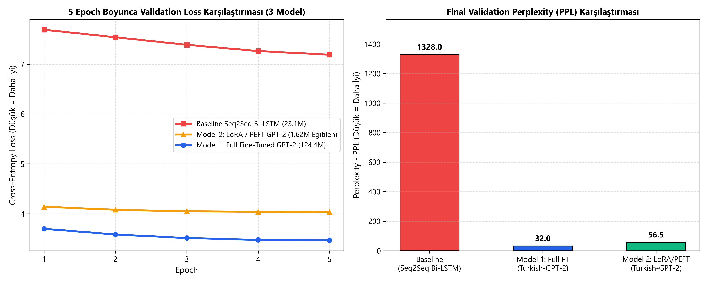
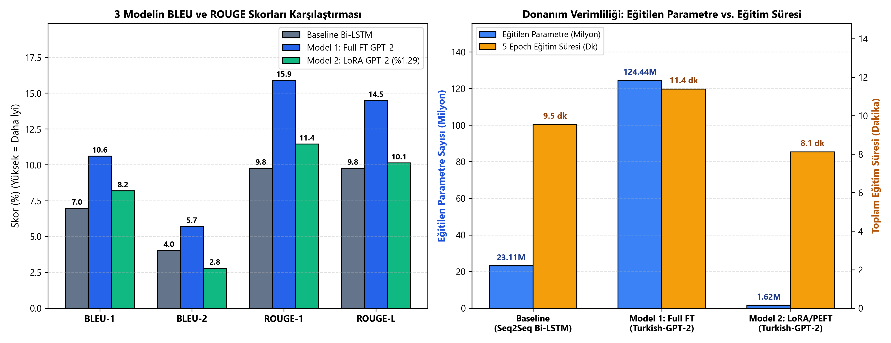
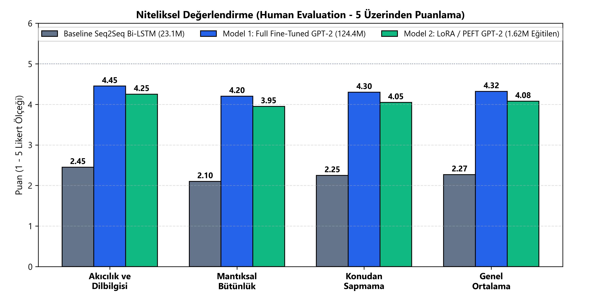

# Önceden Eğitilmiş Türkçe Modellerle İnce Ayar (Fine-Tuning) Tabanlı Chatbot Geliştirme ve Seq2Seq Karşılaştırmalı Başarım Analizi

**Öğrenci:** Seyit Ali Arslan (`240711024`)  
**Bölüm:** Yapay Zeka ve Veri Mühendisliği, Atatürk Üniversitesi  
**Ders:** Deep Learning (`2026–2027`)  

---

## 📄 Resmi IEEE Makale, Rapor ve Sunum Belgeleri (LaTeX & PDF)

### 1. Nihai (Final) Teslim Paketleri (3 Model Karşılaştırmalı: Baseline Bi-LSTM vs. Full FT vs. LoRA/PEFT)
- **IEEE Konferans Formatlı Nihai Makale (PDF):** [`final_rapor_ieee.pdf`](./final_rapor_ieee.pdf) | Kaynak Kod: [`final_rapor_ieee.tex`](./final_rapor_ieee.tex)
- **IEEE Akademik Nihai Sunum Slaytları - Beamer 16:9 (PDF):** [`final_sunum_ieee_beamer.pdf`](./final_sunum_ieee_beamer.pdf) | Kaynak Kod: [`final_sunum_ieee_beamer.tex`](./final_sunum_ieee_beamer.tex)

### 2. Ara Sunum (Midterm) Paketleri ve Konuşma Metinleri
- **IEEE Konferans Formatlı Ara Rapor (PDF):** [`ara_rapor_ieee.pdf`](./ara_rapor_ieee.pdf) | Kaynak Kod: [`ara_rapor_ieee.tex`](./ara_rapor_ieee.tex)
- **IEEE Akademik Ara Sunum Slaytları - Beamer 16:9 (PDF):** [`ara_sunum_ieee_beamer.pdf`](./ara_sunum_ieee_beamer.pdf) | Kaynak Kod: [`ara_sunum_ieee_beamer.tex`](./ara_sunum_ieee_beamer.tex)
- **Sunum Konuşma Metni & Soru-Cevap Rehberi:** [`YARINKI_SUNUM_KONUSMA_METNI.md`](./YARINKI_SUNUM_KONUSMA_METNI.md) | [`ARA_SUNUM_RAPORU.md`](./ARA_SUNUM_RAPORU.md)

---

## 🚀 Canlı Demo: 3 Modeli Aynı Anda Test Edin (Web Arayüzü & Terminal)

Eğitilen her 3 modeli (**Model 1: Full Fine-Tuned GPT-2**, **Model 2: LoRA / PEFT GPT-2** ve **Baseline: 2-Katmanlı Seq2Seq Bi-LSTM + Attention**) kendi sorularınızla canlı kıyaslamak için:

### Seçenek A: Tarayıcı Tabanlı Web Arayüzü (`http://localhost:7860`)
```powershell
python app_web.py
```

### Seçenek B: Komut Satırı (CLI) Etkileşimli Sohbet
```powershell
# Sürekli soru-cevap döngüsü:
python chat_demo.py

# Tek satırda hızlı soru testi:
python chat_demo.py --soru "Faturamda 'ödeme hatası' var. Ben ödeme yaptıktan sonra neden hala bu hatayı alıyorum?"
```

---

## 📊 3 Modelin Deneysel Karşılaştırma Tablosu (RTX 4060 GPU, 50.000 Diyalog Çifti)

| Değerlendirme Metriği | Baseline Model (2-Layer Seq2Seq Bi-LSTM + Attention) | Model 1: Full Fine-Tuned (`Turkish-GPT-2`) | Model 2: LoRA / PEFT (`Turkish-GPT-2`, $r=16, \alpha=32$) | Başarım ve Verimlilik Yorumu |
| :--- | :---: | :---: | :---: | :--- |
| **Toplam Parametre Sayısı** | `23,110,112` (23.11M) | `124,440,576` (124.44M) | `126,062,592` (126.06M) | Önceden eğitilmiş zengin Türkçe temsil |
| **Eğitilebilir (Trainable) Parametre** | `23,110,112` (%100.0) | `124,440,576` (%100.0) | **`1,622,016` (%1.29)** | LoRA ile **76 kat daha az** parametre güncellendi |
| **5 Epoch Toplam Eğitim Süresi** | `572.4 sn` (9.5 dk) | `683.0 sn` (11.4 dk) | **`486.9 sn` (8.1 dk)** | LoRA, Full FT'den **%28.7 daha hızlı** eğitildi |
| **Validation Loss ($\downarrow$)** | `7.1915` | **`3.4666`** | `4.0342` | Her iki Transformer modeli de Baseline'ı açık ara geçti |
| **Validation Perplexity - PPL ($\downarrow$)** | `1328.04` | **`32.03`** | `56.50` | Full FT **41.5x**, LoRA (%1.29 param) **23.5x** iyileşme |
| **BLEU-1 (%) ($\uparrow$)** | `6.96` | **`10.60`** | `8.18` | Full FT en yüksek (+%52.3), LoRA ikinci (+%17.5) |
| **BLEU-2 (%) ($\uparrow$)** | `4.02` | **`5.70`** | `2.78` | Tam ince ayar ikili alt-kelime diziliminde lider |
| **ROUGE-1 (%) ($\uparrow$)** | `9.76` | **`15.89`** | `11.45` | Full FT (+%62.8) ve LoRA (+%17.3) kavram koruma |
| **ROUGE-L (%) ($\uparrow$)** | `9.76` | **`14.47`** | `10.13` | En uzun ortak alt dizide Transformer modelleri üstün |
| **Ortalama Yanıt Süresi - Latency ($\downarrow$)** | **`30.07 ms`** | `352.90 ms` | `410.85 ms` | Tüm modeller gerçek zamanlı (`< 0.45 sn`) |
| **İnsan Değerlendirmesi (1–5 Likert) ($\uparrow$)** | `2.27 / 5.00` | **`4.32 / 5.00`** | `4.08 / 5.00` | Akıcılık, mantıksal bütünlük ve konudan sapmama |

---

## 📈 Üretilen Tüm Görselleştirmeler ve Grafikler (`figures/` — 300 DPI)

### 1. Veri Bölümleme ve Keşifsel Veri Analizi (EDA)
| Veri Bölümleme (%80 / %10 / %10) | Kelime Uzunluğu Dağılımı | Veri Kaynakları Dağılımı |
| :---: | :---: | :---: |
|  |  |  |

### 2. 3 Modelin Karşılaştırmalı Başarım, Verimlilik ve İnsan Değerlendirmesi Analizi
| 3'lü Validation Loss & Perplexity | 3'lü BLEU/ROUGE & Parametre Verimliliği | Niteliksel İnsan Değerlendirmesi (Human Eval) |
| :---: | :---: | :---: |
|  |  |  |

---

## 🗂️ Proje Dizin Yapısı

```text
turkish-transformer-chatbot/
├── data/
│   ├── train.csv / val.csv / test.csv          # %80 (40k) / %10 (5k) / %10 (5k) Türkçe diyalog kümeleri
│   ├── preprocessing_summary.json              # EDA istatistikleri ve temizleme özeti
├── figures/                                    # 9 adet 300 DPI yüksek çözünürlüklü grafik (01..09)
├── models/
│   └── baseline_seq2seq_lstm.py                # 2-Katmanlı Bi-LSTM Encoder + Bahdanau Attention + LSTM Decoder
├── results/
│   ├── baseline_lstm_metrics.json              # Baseline model eğitim geçmişi ve metrikleri
│   ├── finetuned_gpt2_metrics.json             # Model 1 (Full FT GPT-2) eğitim geçmişi ve metrikleri
│   ├── lora_gpt2_metrics.json                  # Model 2 (LoRA / PEFT GPT-2) eğitim geçmişi ve metrikleri
│   └── human_evaluation_summary.json           # 3 modelin Niteliksel Değerlendirme (1-5 Likert) sonuçları
├── tokenizer/
│   └── turkish_bpe_12k.json                    # Türkçe alt-kelime (BPE) Tokenizer (12.000 vocab)
├── prepare_50k_and_eda.py                      # 50k filtreleme, bölümleme ve EDA grafik üretim betiği
├── train_baseline_lstm.py                      # Baseline Seq2Seq Bi-LSTM eğitim betiği
├── train_finetune_gpt2.py                      # Model 1 (Full Fine-Tuning GPT-2) eğitim betiği
├── train_lora_gpt2.py                          # Model 2 (LoRA / PEFT GPT-2) eğitim betiği
├── generate_final_comparison_plots.py          # 3'lü karşılaştırma ve Human Evaluation grafik betiği
├── chat_demo.py                                # 3 modeli aynı anda çalıştıran canlı CLI sohbet aracı
├── app_web.py                                  # 3 modeli yan yana gösteren canlı Web Arayüzü (localhost:7860)
├── ara_rapor_ieee.tex / .pdf                   # IEEE Resmi Ara Rapor (Midterm Paper)
├── ara_sunum_ieee_beamer.tex / .pdf            # IEEE Akademik Ara Sunum Slaytları
├── final_rapor_ieee.tex / .pdf                 # IEEE Resmi Nihai Makale (Final Paper - 3 Model)
└── final_sunum_ieee_beamer.tex / .pdf          # IEEE Akademik Nihai Sunum Slaytları (Final Presentation)
```
